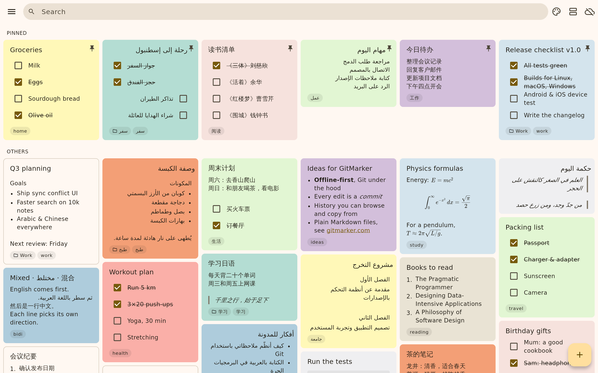
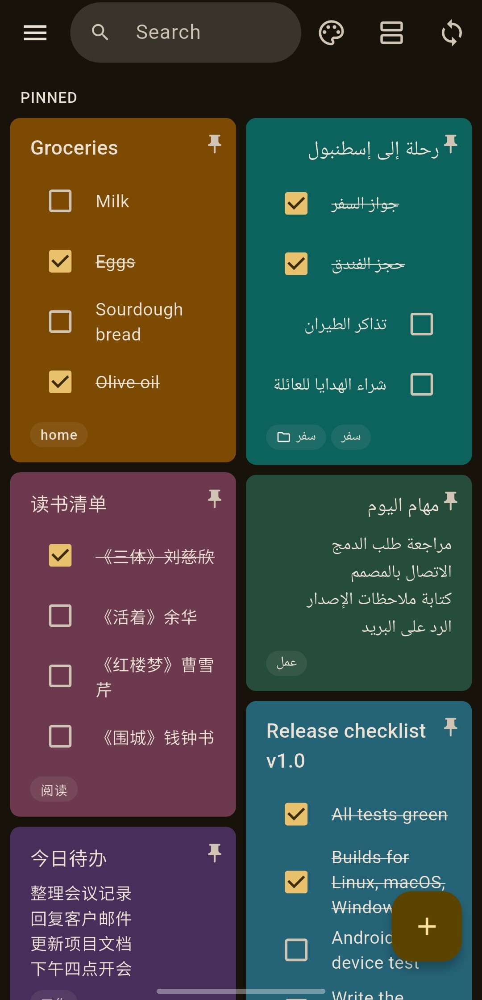

# GitMarker

Markdown notes with a Google Keep–style interface, stored in a Git
repository. Every change is a commit, and sync is plain Git: a local path,
HTTPS or SSH. Git runs through [dargit](https://github.com/mohamed/dargit),
a pure-Dart Git, so no Git installation or native library is needed.
Arabic, Chinese and any mix of scripts are laid out line by line, right to
left where needed.

<p align="center">
  
  
</p>

## Features

- **Keep-style notes.** Create, edit, pin, colour, label and delete notes in
  a masonry grid; deleting offers Undo. Folders, labels and a colour filter
  narrow the grid; search ignores Arabic diacritics and letter variants.
- **Checklists.** `- [ ]` / `- [x]` items can be ticked right on the card or
  in the note.
- **Markdown preview.** Headings, lists, quotes, code blocks, **bold**,
  *italic*, links and TeX math (`$…$`, `$$…$$`) are rendered on the cards
  and in the note.
- **Plain files.** Every note is a `.md` file. *Plain* notes are ordinary
  Markdown, titled by their first `# heading` (or the file name); *managed*
  notes keep pin, colour and labels in YAML front matter and preserve any
  keys they do not know. Existing repositories are scanned recursively;
  files with broken front matter are listed with the reason.
- **Git all the way down.** Create, save, move and delete are commits
  (`Create note: …`, `Update note: …`, …). Notes edited by other programs
  are picked up when the app comes back to the front.
- **Sync.** Fast-forward, push, or rebase local commits onto the remote. On
  a conflict the rebase is aborted, nothing is changed, and you choose: keep
  the remote version, force push yours (refused if the remote moved again),
  or leave both as they are. Network operations time out instead of
  hanging.
- **History.** Browse each note's commits, older and newer, following
  renames and moves; copy from any version; jump back to the latest.
- **Remotes.** HTTPS with a personal access token, SSH with a key file
  (passphrase optional) or the SSH agent; unencrypted `http://` is
  refused. SSH host keys are trusted on
  first use and pinned afterwards. Settings are checked before anything is
  cloned; switching to another remote asks first and can keep a backup.
- **Fast.** Notes are scanned on a background isolate with a parse cache:
  5,000 notes load in 0.7 s the first time and 0.1 s after that, and a
  save takes about 0.16 s.

## Platforms

| Platform | Status |
|---|---|
| Linux | Built and run |
| Android | Built in CI and tested on a device |
| iOS, macOS, Windows | Built in CI; device testing pending |
| Web | Not supported yet (planned) |

CI uploads installable builds for every platform (GitHub → Actions → a
run on `main` → **Artifacts**).

## Build and test

`android/` is committed; the other platform folders are generated:

```sh
flutter create --empty --org com .   # ios/, linux/, macos/, windows/, web/
dart run flutter_launcher_icons       # app icons from assets/icon/
flutter run -d linux                           # or macos, windows, an Android/iOS device
flutter build linux --release                  # or apk, ios, macos, windows

dart format lib test && flutter analyze && flutter test
flutter test test/network --run-skipped        # SSH (starts a local sshd) and HTTPS (internet)
```

Built with Flutter 3.47.7 (the version CI pins). Notes live in the platform
application-support directory under `gitmarker_data/`; configure a remote
in **Settings**.

## Architecture

Each layer has one job, and calls only go downwards:

```
ui.dart ──▶ controller.dart ──▶ note_store.dart   (files)
                            └─▶ git.dart          (Git)
              all of them use note_models.dart and bidi.dart
```

| File | Owns | Never does |
|------|------|------------|
| `lib/ui.dart` | Keep-style presentation and user input | File I/O, Git, business rules; it talks only to the controller |
| `lib/controller.dart` | Workflows across store and Git (save → commit → reload, sync, history, settings changes), observable state, filtering | File I/O or Git rules of its own |
| `lib/note_store.dart` | All file storage: notes (Markdown + YAML), folders, the settings file, data-directory moves and backups | Git |
| `lib/git.dart` | All Git rules and workflows (git commands via dargit): commits, sync, history, remote URLs, branch names, settings validation, credentials, host keys | Write or parse notes (it commits the files the store wrote), or touch the UI |
| `lib/note_models.dart` | Data models only | I/O of any kind |
| `lib/bidi.dart` | Text direction and search normalization | I/O of any kind |
| `lib/main.dart` | Flutter entry point | — |

Only `main.dart` and `ui.dart` import Flutter, so everything below the UI
is plain Dart and is tested without widgets: the store against real files,
Git and the controller against dargit and local bare repositories.

## License

GitMarker is distributed under the BSD 3-Clause license. See [LICENSE](LICENSE).
